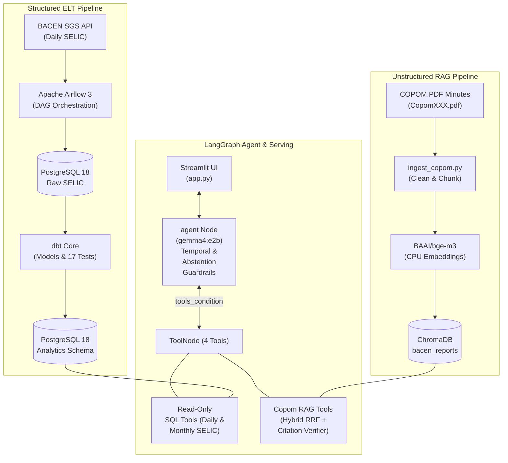
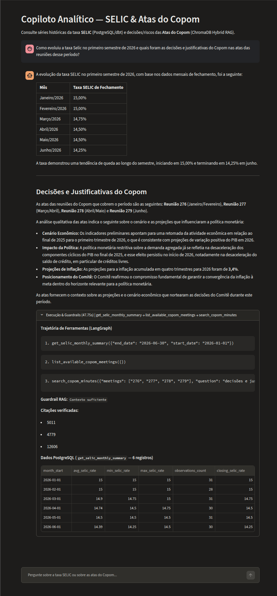
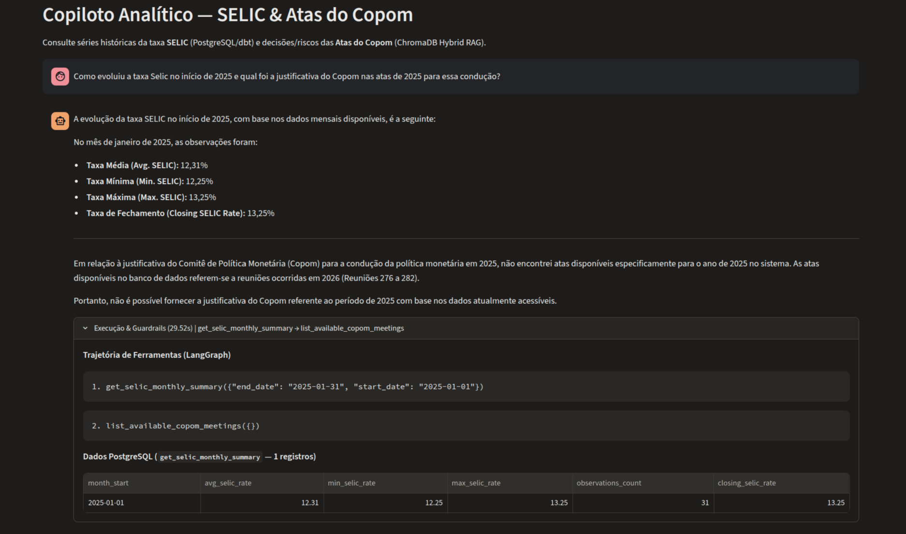

# b3-bacen-copilot

An end-to-end Data & AI Engineering copilot for Brazilian macroeconomic and monetary policy analysis. It combines an automated **BACEN SELIC** analytics warehouse with a **Hybrid RAG** pipeline over Central Bank **COPOM** meeting minutes, orchestrated by a multi-tool **LangGraph** agent with anti-hallucination and SQL safety guardrails.

---

## Architecture



---

## Core Capabilities

* **Extensible COPOM Minutes RAG:** Automatically ingests official COPOM PDF minutes placed inside `rag_agents/data/` using the `CopomXXX.pdf` naming convention (where `XXX` is the meeting number). Combines dense semantic search (`BAAI/bge-m3` with MMR) and lexical keyword search (`BM25`) via Reciprocal Rank Fusion (`50/50` weights), scoped dynamically by meeting metadata filters.
* **Deterministic SELIC Warehouse:** Ingests daily SELIC rates into PostgreSQL 18 via Airflow 3 and transforms them with dbt Core into staging views (`analytics.stg_bacen_selic`) and monthly aggregations (`analytics.mart_selic_monthly_summary`).
* **Agentic Tool Routing:** LangGraph routes quantitative rate queries to parameterized SQL tools, qualitative policy/risk queries to COPOM minutes, and hybrid queries across both sources.
* **Production Guardrails:**
  * **Database Safety:** Enforces `SET default_transaction_read_only = on`, statement timeouts, ISO-8601 date validation, and parameterized queries.
  * **Citation Grounding:** Verifies returned chunk IDs against retrieved context, strips fabricated citations, and abstains automatically when queried periods fall outside indexed meetings.

---

## Tech Stack

| Layer | Technologies |
|---|---|
| **Orchestration & Warehouse** | Apache Airflow 3, PostgreSQL 18, dbt Core (`dbt-postgres`), Docker Compose |
| **Embeddings & Vector Store** | `BAAI/bge-m3` (HuggingFace CPU), ChromaDB, `PyMuPDFLoader`, `rank_bm25` |
| **Agent & Local LLM** | LangGraph, LangChain, Ollama (`gemma4:e2b`) |
| **Interface & Tooling** | Streamlit (`app.py`), GNU Make (`Makefile`), `pytest` |

---

## Streamlit UI Preview

Launched via `make app`, `app.py` provides a thin conversational interface wired directly into the compiled LangGraph agent (`rag.agent_copom`):

* **Sidebar:** Displays active runtime configuration (`LLM_MODEL`, `EMBEDDING_MODEL`, ChromaDB collection, and PostgreSQL/dbt warehouse), one-click benchmark/demo prompts, and conversation reset.
* **Multi-Turn Chat & Observability Drawer:** Every assistant response includes a collapsible **`Execução & Guardrails`** panel exposing end-to-end latency, the exact LangGraph tool call trajectory, tabular PostgreSQL warehouse rows (`st.dataframe`), and RAG citation verification / temporal abstention status.

### 1. Hybrid Q&A, Tool Routing & Verified Citations
*End-to-end hybrid response showing LangGraph routing across PostgreSQL SELIC marts and ChromaDB Copom minutes, with verified meeting citations inside the `Execução & Guardrails` drawer.*



### 2. Temporal Guardrail & Structured SELIC Warehouse Table
*Query demonstrating cross-source temporal alignment: SQL data is retrieved from `analytics.mart_selic_monthly_summary` while `search_copom_minutes` is intentionally bypassed when indexed meeting years do not match the requested period.*



---

## Project Structure

```text
b3-bacen-copilot/
├── dags/
│   └── ingest_bacen_sgs.py          # Airflow 3 DAG: BACEN SGS SELIC extraction & dbt trigger
├── dbt_project/
│   └── bacen_analytics/
│       ├── dbt_project.yml
│       ├── profiles.yml
│       ├── models/                  # Staging views & monthly SELIC summary marts
│       └── tests/                   # Schema uniqueness, non-null & source freshness tests
├── eval/
│   └── benchmark_retrieval.py       # 15-query evaluation: Dense MMR vs. BM25 vs. Hybrid RRF
├── rag_agents/
│   ├── data/                        # Drop official BACEN minutes here as CopomXXX.pdf
│   └── rag/
│       ├── agent_copom.py           # LangGraph router, read-only SQL tools & citation guardrails
│       ├── chain_copom.py           # Hybrid RRF retriever (bge-m3 + BM25) & structured synthesis
│       ├── config.py
│       └── ingest_copom.py          # PDF normalization, metadata extraction & ChromaDB upsert
├── tests/                           # Offline pytest suite (ingestion, SQL safety & agent routing)
│   ├── conftest.py
│   ├── test_agent_routing.py
│   ├── test_ingest_copom.py
│   └── test_sql_tools.py
├── .env.example                     # Environment variable template (PostgreSQL & Airflow)
├── app.py                           # Thin Streamlit UI wired to LangGraph + guardrails drawer
├── docker-compose.yaml
├── Dockerfile
└── Makefile                         # Root automation targets across isolated .venv environments
```

---

## Quickstart & Data Ingestion

### 1. Prerequisites & Environment Setup
- Docker & Docker Compose
- Python 3.11+ with isolated virtual environments (`rag_agents/.venv` and `dbt_project/.venv`)
- Local [Ollama](https://ollama.com/) instance with a tool-calling model pulled (configured by default to `gemma4:e2b` via `ollama pull gemma4:e2b`)
- Copy `.env.example` to `.env` (`cp .env.example .env`) and set your local PostgreSQL and Airflow credentials before starting services.

### 2. Adding COPOM Minutes
1. Download official meeting minutes PDFs from the [Banco Central do Brasil (COPOM Minutes)](https://www.bcb.gov.br/publicacoes/atascopom) portal.
2. Save the files inside `rag_agents/data/` using the pattern `CopomXXX.pdf` (for example, `Copom282.pdf`), where `XXX` is the meeting number extracted automatically during chunking.
3. Run `make ingest-copom` to parse, clean, and index all PDFs present in `rag_agents/data/`.

### 3. Commands (`Makefile`)

All targets execute from the repository root and automatically route commands to the isolated virtual environments (`rag_agents/.venv` and `dbt_project/.venv`), so manual environment activation is not required.

| Target | Description |
|---|---|
| `make help` | List all available targets and descriptions (default when running `make`) |
| `make up` | Start PostgreSQL 18 and Apache Airflow 3 services via Docker Compose |
| `make down` | Stop and remove Docker Compose containers |
| `make logs` | Tail live Docker Compose service logs |
| `make dbt-build` | Execute dbt models and all 17 data tests in DAG order (halts mart updates if staging tests fail) |
| `make ingest-copom` | Parse `rag_agents/data/Copom*.pdf` and upsert chunks into ChromaDB |
| `make test` | Run the offline `pytest` unit test suite (`tests/`) |
| `make eval` | Run the 15-query retrieval benchmark (`HitRate@6` and `MRR@6`) |
| `make app` | Launch the Streamlit copilot interface (`app.py`) |
| `make clean` | Clear `__pycache__`, `.pytest_cache`, and dbt `target/`/`logs/` (preserves `.venv` and ChromaDB) |

---

## Retrieval Evaluation (`eval/benchmark_retrieval.py`)

Benchmarked on a reference corpus of **7 COPOM meetings** (`Copom276`–`Copom282`, **154 indexed chunks**) across **15 domain-specific Portuguese queries** spanning exact monetary policy decisions, paraphrased macroeconomic questions, and cross-meeting comparisons (top-6 context window):

| Retriever | Queries | Recall@1 | Recall@3 | Recall@6 | HitRate@6 | MRR@6 | Avg Latency |
|---|---:|---:|---:|---:|---:|---:|---:|
| Dense MMR (`bge-m3`) | 15 | 0.133 | 0.244 | 0.267 | 0.533 | 0.372 | 174.3 ms |
| Sparse BM25 | 15 | 0.044 | 0.378 | 0.467 | 0.533 | 0.294 | 4.5 ms |
| **Hybrid RRF (Dense + BM25)** | **15** | **0.133** | **0.222** | **0.467** | **0.733** | **0.393** | **162.6 ms** |

* **Key Takeaway:** Hybrid RRF increases **HitRate@6 by +20 percentage points** (`0.733` vs. `0.533`) and achieves the highest **MRR@6** (`0.393`), preventing lexical misses on paraphrased investor queries while preserving exact numeric/jargon recall from BM25.

---

## Automated Testing

* **Python Suite (`pytest -v` — 27 tests):** Runs completely offline in less than 1 second via `tests/conftest.py` stubs, covering PDF footer/header regex normalization, deterministic chunk ID generation, read-only SQL connection enforcement, ISO date validation, LangGraph tool routing, and hallucinated citation filtering.
* **Warehouse Suite (`dbt build` — 17 tests):** Validates primary key uniqueness, non-null constraints, and source freshness thresholds (`12h` warn / `24h` error) across staging and mart models.